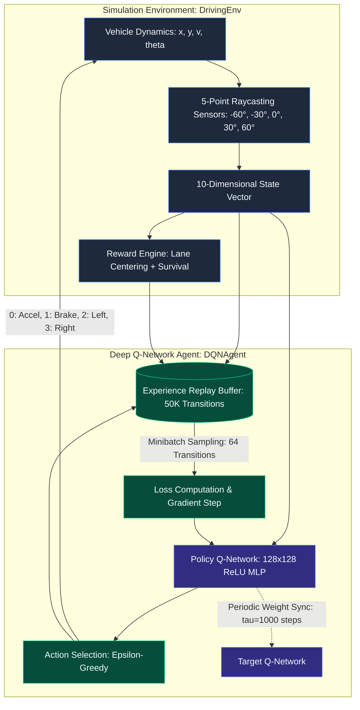

# 🚗 Autonomous Vehicle Deep Q-Learning (DQN) Navigation Agent

An end-to-end **Deep Reinforcement Learning (DQN) autonomous driving agent** trained in PyTorch to navigate continuous 2D highway lanes and challenging sine-wave curves. Features continuous distance ray-casting sensors, experience replay memory, target network stabilization, and Pygame interactive simulation rendering.

[](LICENSE)
[](https://pytorch.org/)
[](https://www.python.org/)

---

## 🏗️ System Architecture



---

## 🧠 Reinforcement Learning Formulation

### 1. State Space (10 Dimensions)
Normalized continuous sensory inputs:
- $x$: Normalized longitudinal vehicle coordinate
- $y$: Normalized lateral vehicle coordinate
- $v$: Normalized vehicle velocity ($0.0$ to $8.0\text{ m/s}$)
- $\theta$: Normalized vehicle heading orientation angle
- $d_{\text{center}}$: Normalized lateral displacement from optimal lane center
- $s_{-60^\circ}, s_{-30^\circ}, s_{0^\circ}, s_{+30^\circ}, s_{+60^\circ}$: Five continuous range-finder lidar distance readings to lane boundaries

### 2. Action Space (4 Discrete Actions)
| Action ID | Operational Command | Dynamics Effect |
|:---:|:---:|:---|
| `0` | **Accelerate** | Increases forward speed by acceleration rate |
| `1` | **Brake / Decelerate** | Decreases forward velocity |
| `2` | **Steer Left** | Adjusts heading orientation counter-clockwise |
| `3` | **Steer Right** | Adjusts heading orientation clockwise |

### 3. Reward Function
$$R_t = 1.0 - 0.01 \cdot |d_{\text{center}}|$$
- **Survival Bonus**: Positive continuous reward for maintaining stable forward progress.
- **Centering Penalty**: Penalizes deviation from the lane geometric center.
- **Terminal Crash Penalty**: $-50.0$ penalty inflicted upon touching boundary margins or leaving road bounds.

---

## 🚀 Quick Start

### 1. Installation

```bash
# Clone repository
git clone https://github.com/snowowl69/self-driving-car-dqn.git
cd self-driving-car-dqn

# Create and activate virtual environment
python -m venv .venv

# Windows activation
.\.venv\Scripts\Activate.ps1

# Linux / macOS activation
source .venv/bin/activate

# Install dependencies
pip install -r requirements.txt
```

### 2. Training the Agent

```bash
# Train on straight road environment
python main.py --train --episodes 500

# Train on curved road (sine-wave track)
python main.py --train --episodes 800 --curved

# Train with narrow road difficulty
python main.py --train --episodes 1000 --curved --narrow
```

### 3. Visual Simulation & Inference (Pygame)

```bash
# Run real-time visual simulation with the pre-trained weights
python main.py --eval --model-path results/model.pth --render
```

---

## 📁 Repository Structure

```
self-driving-car-dqn/
├── main.py              # CLI training and evaluation entry point
├── driving_env.py       # Custom 2D vehicle dynamics & ray-casting environment
├── dqn_agent.py         # DQNAgent with epsilon decay & target network updates
├── model.py             # PyTorch DQN MLP neural network architecture
├── replay_buffer.py     # High-throughput circular experience replay buffer
├── requirements.txt     # Python dependencies (torch, pygame, numpy, matplotlib)
├── LICENSE              # MIT Open-Source License
├── README.md            # Architectural reference & benchmark documentation
└── results/
    └── model.pth        # Pre-trained deep reinforcement learning policy weights
```

---

## 📈 Training Convergence

- **Early Phase (Episodes 1–100)**: High exploratory behavior ($\epsilon \approx 1.0 \to 0.5$). Frequent lane boundary breaches.
- **Mid Phase (Episodes 100–350)**: Experience replay buffer stabilizes gradients. Vehicle learns basic straight-line stabilization.
- **Converged Phase (Episodes 350+)**: Low exploration ($\epsilon \to 0.05$). Agent learns proactive counter-steering on curved sine roads, maintaining sub-pixel centering.

---

## 📄 License

This project is open-source under the [MIT License](LICENSE).

---

## 📬 Author & Links

**Raghavendra**  
- GitHub: [@snowowl69](https://github.com/snowowl69)  
- Repository: [https://github.com/snowowl69/self-driving-car-dqn](https://github.com/snowowl69/self-driving-car-dqn)
